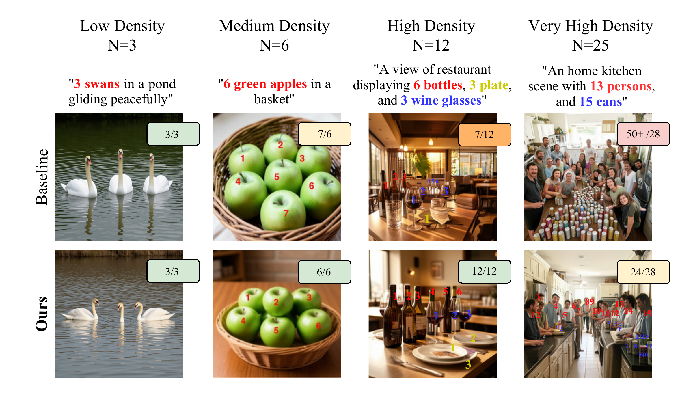
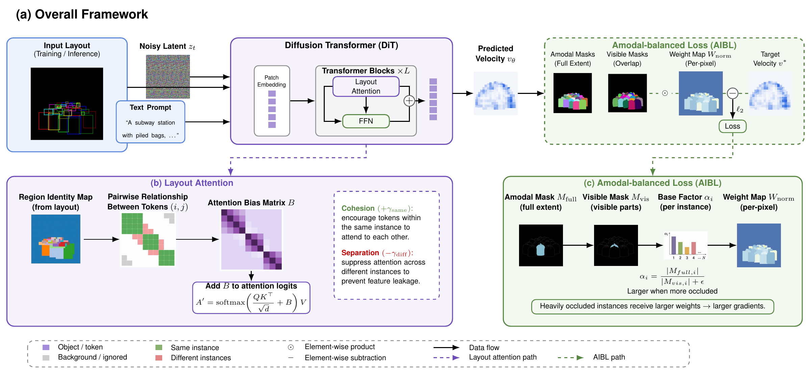
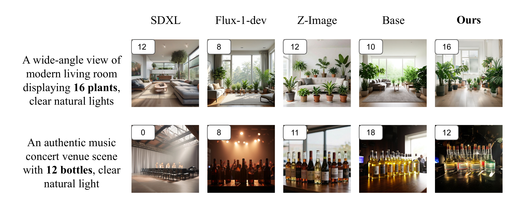

<div align="center">

# Learning to Generate Multiple Objects from Dense and Occluded Layouts

**AIBL — Ownership-Aware Layout Attention + Amodal-Aware Instance-Balanced Loss**

[](https://bachngoh.github.io/AIBL/)
[](https://arxiv.org/abs/2607.03488)
[](https://huggingface.co/datasets/BachNgoH/OverlapDepth-45K)
[](LICENSE)
[](pyproject.toml)

[Project Page](https://bachngoh.github.io/AIBL/) · [arXiv](https://arxiv.org/abs/2607.03488) · [Code](https://github.com/BachNgoH/AIBL) · [Dataset](https://huggingface.co/datasets/BachNgoH/OverlapDepth-45K) · [Issues](https://github.com/BachNgoH/AIBL/issues)

</div>

## 📢 News

- **Oct 29, 2026** — Official code release: training, inference, and counting evaluation for AIBL.
- **Oct 29, 2026** — OverlapDepth-45K dataset page on Hugging Face: [`BachNgoH/OverlapDepth-45K`](https://huggingface.co/datasets/BachNgoH/OverlapDepth-45K).
- **Sep 2026** — 🎉 **AIBL is accepted at NeurIPS 2026.** Thank you to everyone who supported the work.
- **Jul 2026** — arXiv preprint ([arXiv:2607.03488](https://arxiv.org/abs/2607.03488)) and project page released.

## Overview

Official implementation of **Learning to Generate Multiple Objects from Dense and Occluded Layouts**. The method combines **Ownership-Aware Layout Attention (LA)** with **Amodal-Aware Instance-Balanced Loss (AIBL)**, fine-tuning FLUX.2-Klein using LoRA on **OverlapDepth-45K**.

Text-to-image diffusion models often fail to produce the requested number of objects in dense scenes: overlapping instances collapse into merged structures, and heavily occluded objects receive weak training signal because only small visible regions contribute to the loss. AIBL addresses both — ownership-aware attention biases reduce cross-instance feature leakage, while the amodal-aware instance-balanced loss increases supervision for occluded objects according to their amodal-to-visible area ratio.



*Main-paper teaser: baseline generations (top) and the paper's method (bottom) across increasing scene density.*

## Method overview



*Layout attention guides transformer interactions using bounding-box ownership and spatial priors. During training, AIBL reweights the reconstruction loss using amodal and visible instance areas; inference does not require amodal masks.*

## Qualitative comparisons



*Counting prompts from the paper. Columns show SDXL, FLUX.1-dev, Z-Image, the layout-only baseline (Base), and AIBL (Ours).*

## Installation

```bash
python -m venv .venv
source .venv/bin/activate
python -m pip install -e .
```

Training and image generation require access to `black-forest-labs/FLUX.2-klein-base-4B`, sufficient accelerator memory, and its supported Diffusers implementation. Set `HF_TOKEN` in your environment if model access requires it. Weights and datasets are separate downloads; no pretrained AIBL checkpoint is bundled. CPU checks of the mathematical components do not require downloading a model.

## Data

The dataset is hosted on Hugging Face: [`BachNgoH/OverlapDepth-45K`](https://huggingface.co/datasets/BachNgoH/OverlapDepth-45K).

Download it with the Hugging Face CLI and point `--data_root` at the downloaded directory:

```bash
huggingface-cli download BachNgoH/OverlapDepth-45K --repo-type dataset --local-dir data/overlapdepth
```

Prepare a verified dataset root:

```text
data_root/
  samples/
    000000/
      image.png
      meta.json
      masks.npz
    ...
```

`meta.json` contains `sample_id`, `prompt` (or `global_caption`), `n_objects`, and `instances`. Each instance has a normalized `[x, y, width, height]` bounding box and category; depth metadata determines front-to-back ordering. Larger `depth` values mean nearer objects; `depth_rank=0` means frontmost when depth is unavailable. Optional `overlap_pairs` contain zero-based `front`/`back` list positions. Explicit `front_id`/`back_id` keys instead refer to instance metadata IDs.

Training `masks.npz` must contain matching `amodal_masks` and `modal_masks` arrays of shape `[N,H,W]`, `depth_map` and `ownership_map` of shape `[H,W]`. Individual `amodal_0`, `modal_0`, … keys are also supported. Ownership uses instance indices `0..N-1` and background `-1`; paper IDs are obtained by adding one. Missing or inconsistent required supervision raises an error.

Dataset ranges are **positions in sorted sample directories**, not sample IDs. The examples use the 44,000 training and 1,000 test samples described in the paper. Check the dataset ordering before selecting a range.

## Training

Train the full method with the following recipe. `--steps` counts optimizer updates; each update accumulates `--grad_accum` minibatches.

```bash
aibl-train \
  --data_root data/overlapdepth \
  --output_dir outputs/full \
  --train_start_idx 0 --train_end_idx 44000 \
  --steps 3000 --batch_size 1 --grad_accum 4 \
  --lr 5e-5 --lora_rank 16 --image_size 512 \
  --gamma 0.5 --lambda_bg 0.8 --mix_ratio 1.0 \
  --use_layout_attention --use_overlap_ownership \
  --alpha_max 5 --seed 42
```

Arguments use the paper's symbols:

| Paper quantity | Code / CLI name | Release default |
|---|---|---|
| Intra-instance cohesion, omega_intra | `--omega_intra` | `2.0` |
| Cross-instance separation, omega_inter | `--omega_inter` | `-1.0` |
| Global grounding factor, beta | `--beta` | `2.0` |
| Gaussian bandwidth, sigma | `--sigma` | `sqrt(0.05)` |
| Occlusion boost exponent, gamma | `--gamma` | `0.5` |
| Maximum boost, alpha_max | `--alpha_max` | `5.0` |
| Background weight, lambda_bg | `--lambda_bg` | `0.8` |

Overlap cohesion and separation corrections use the paper's fixed factor of `1/2`. Inference loads attention settings from the saved training configuration.

Use the same data, initialization and training budget for ablations:

| Configuration | Changes to full-method command |
|---|---|
| Ours (Full) | None |
| Basic Layout Attn. + AIBL (gamma=0.5) | `--no-use_overlap_ownership` |
| Basic Layout Attn. | `--no-use_overlap_ownership --no-use_aibl` |

The paper's **Untrained (FLUX.2)** baseline uses the original backbone without a trained adapter. Setting `gamma=0` retains foreground/background reweighting and is not equivalent to disabling AIBL.

## Generation

Generation uses prompts, boxes and depth ordering, without amodal masks. Attention settings load from checkpoint configuration; explicit CLI settings override them. Supplied dataset boxes are an oracle-layout experiment, whereas the paper's fair-layout comparisons use shared LLM-inferred boxes and labels.

```bash
aibl-infer \
  --data_root data/overlapdepth \
  --lora_path outputs/full/lora_final \
  --output_dir outputs/generated \
  --start_idx 44000 --end_idx 45000 --num_samples 1000 \
  --image_size 512 --num_inference_steps 20 \
  --guidance_scale 3.5 --seed 42 --device cuda \
  --save_metadata
```

The example range assumes the 45,000-sample dataset ordering described above. For shared inferred layouts, add `--layout_dir path/to/shared_layouts`. Each file is named by sample ID, such as `044000.json`, and contains `prompt`, `instances` with finite normalized boxes, and optional `overlap_pairs`. Preserve identical layout files for every compared layout-conditioned method. Invalid layouts fail before loading the model. `--resume --save_metadata` retains existing metadata for skipped images and merges newly generated records by sample ID.

Run `aibl-train --help` and `aibl-infer --help` for complete supported options. The Python package, distribution, and project folder are named `aibl`. Source launchers are `scripts/train.py`, `scripts/inference.py`, and `scripts/evaluate_counts.py`.

## Validation and evaluation

Run the CPU regression suite:

```bash
python -m unittest discover -s tests -v
```

For pretrained training/generation, use a CUDA device with sufficient memory. `--device auto` selects CUDA when available and CPU otherwise; `--precision auto` selects bf16 on supported CUDA devices and fp32 otherwise. Set `--precision fp32` for a CUDA device without bf16 support.

The paper reports counting metrics over `(image, target category)` pairs: exact match, strict relative tolerances `|prediction-target| / target <= 0.10` and `<= 0.20`, MAE, and RMSE. Fixed `±1`/`±2` tolerances are different metrics.

`aibl-eval` scores existing count records; it does not run a detector. Its input is a JSON array with one record per target image/category:

```json
[
  {"sample_id": "000001", "category": "apple", "predicted": 5, "ground_truth": 5},
  {"sample_id": "000001", "category": "bottle", "predicted": 2, "ground_truth": 3}
]
```

```bash
aibl-eval --input counts.json --output metrics.json
```

Accuracies are fractions in `[0,1]`. Include every evaluated target pair, including zero detections. Detector/model revisions, thresholds, category normalization, layouts and sampled IDs must be frozen before comparing methods. This release scores count records; it does not bundle the detector or human evaluation pipeline.

## Citation

If you find this work useful, please cite the arXiv preprint:

```bibtex
@misc{ngo2026aibl,
  title         = {Learning to Generate Multiple Objects from Dense and Occluded Layouts},
  author        = {Ngo, Bach-Hoang and Ngo, Si-Tri and Le, Hieu and Le, Trung-Nghia},
  year          = {2026},
  archivePrefix = {arXiv},
  eprint        = {2607.03488},
  primaryClass  = {cs.CV},
  url           = {https://arxiv.org/abs/2607.03488}
}
```

The NeurIPS 2026 proceedings are not published yet; this entry will be updated to the official proceedings once they are available.

## License

This repository is released under the [MIT License](LICENSE). Code, figures, and documentation are provided for research use; please cite the paper above when you build on this work.

## Acknowledgements

We thank our co-authors and advisors, and the NeurIPS 2026 reviewers for their feedback. Please open an issue for questions, bugs, or feature requests.
